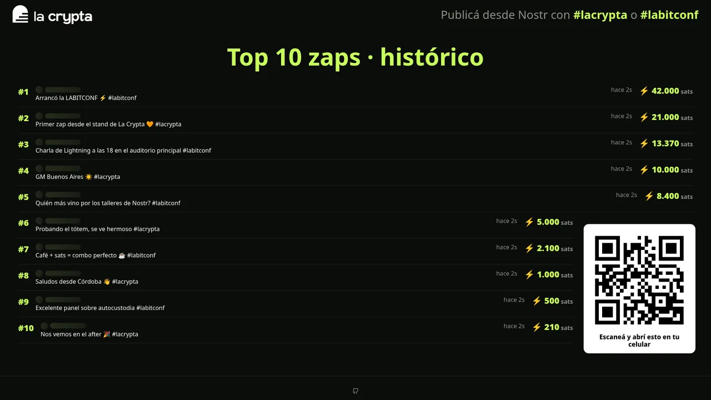
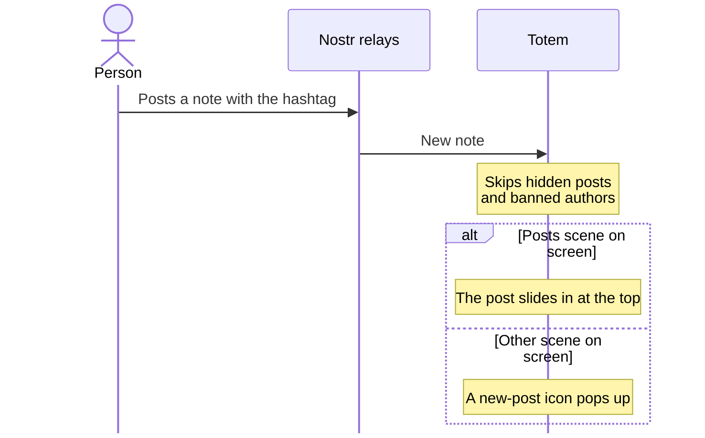
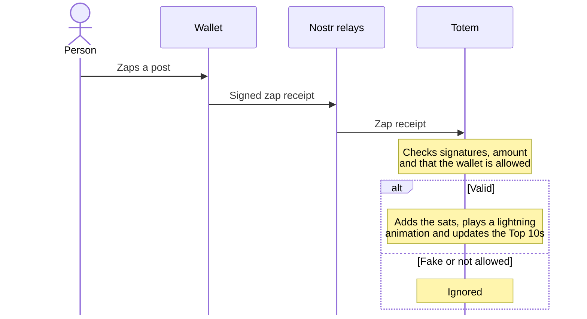
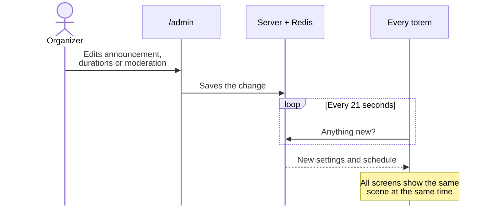

<div align="center">

# ⚡ totemcillo

**La Crypta**'s totem screen for **LABITCONF**: live Nostr notes and the zaps they receive.




</div>

## What it does

- Shows notes tagged `#lacrypta` and `#labitconf` live, with their zap totals.
- Rotates scenes: latest posts, latest zaps, two Top 10s, an announcement and a video.
- Every totem shows the same scene at the same time (server clock).
- The same URL on a phone shows a mobile view with a ⚡ Zap button.

## How it works

**A post appears:** anyone can get on the screen by posting on Nostr with the hashtag.



**A zap is counted:** only real payments add sats.



**An organizer changes something:** every screen follows within about 21 seconds.



## Getting started

```bash
pnpm install
pnpm dev      # http://localhost:5173 and /admin
pnpm test
pnpm build
```

| Variable | Purpose |
| --- | --- |
| `ADMIN_PASSWORD` | `/admin` password (`admin` locally if unset) |
| `SESSION_SECRET` | Session signing key (32+ characters) |
| `UPSTASH_REDIS_REST_URL` | Upstash Redis URL |
| `UPSTASH_REDIS_REST_TOKEN` | Upstash Redis token |

- **Deploy:** Vercel + Upstash; both Redis variables are required in production.
- **Admin:** `/admin` (password): announcement, scene durations, video, start line, zap providers and moderation.
- **Dev tools:** `pnpm dev` adds buttons to simulate posts/zaps and step through scenes.
- **Zaps:** validated per NIP-57, only from an allowlist of LNURL providers.

<div align="center"><sub>ISC © 2026 Fierillo · Built for <b>La Crypta</b> 🧡</sub></div>
